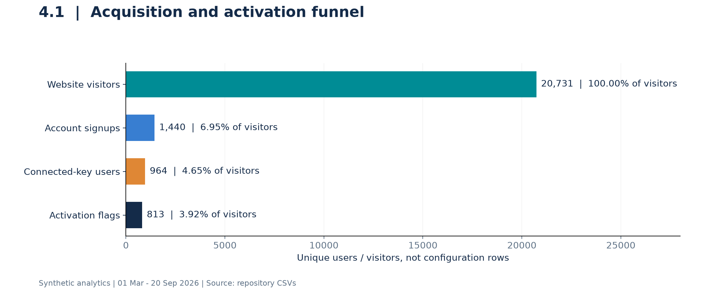
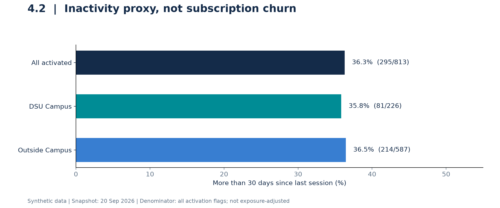
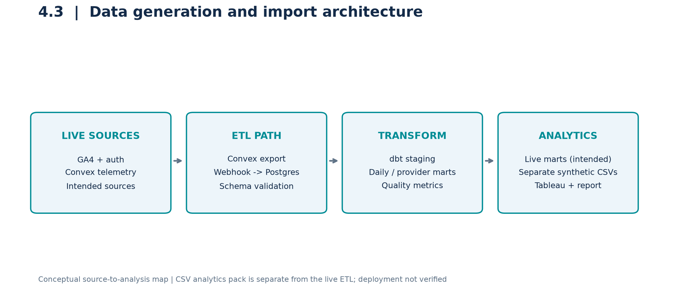
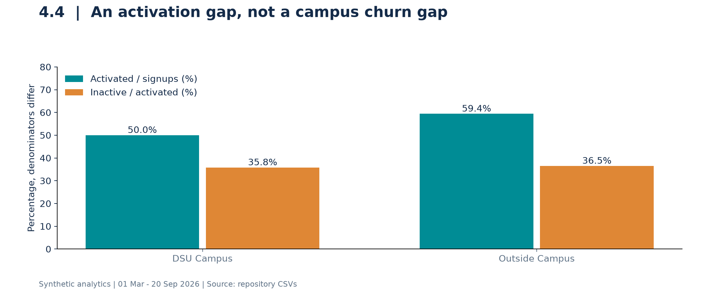
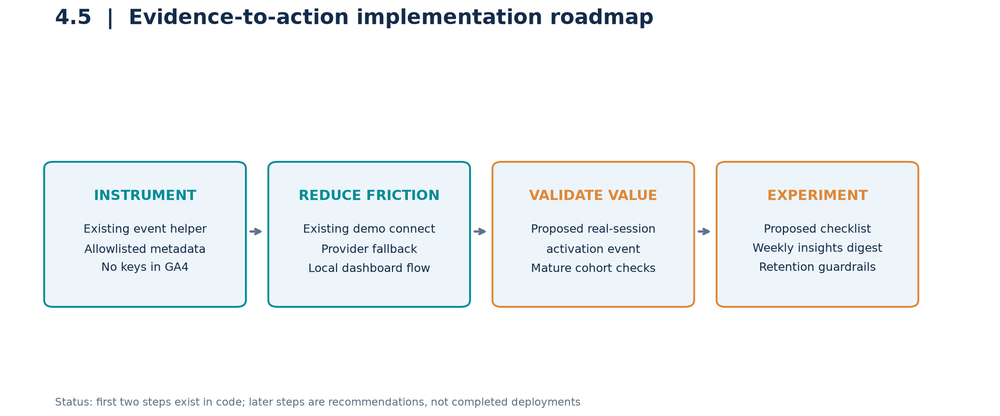
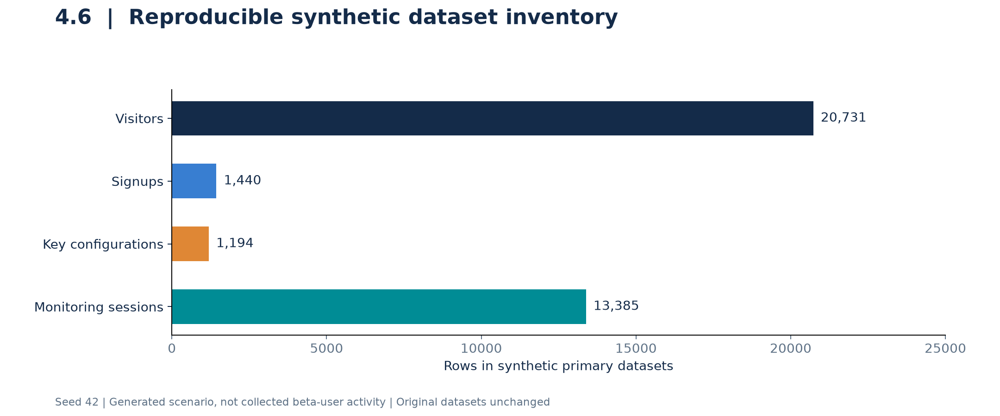
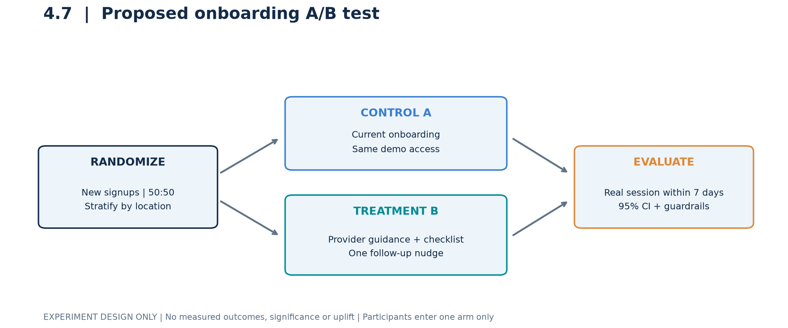
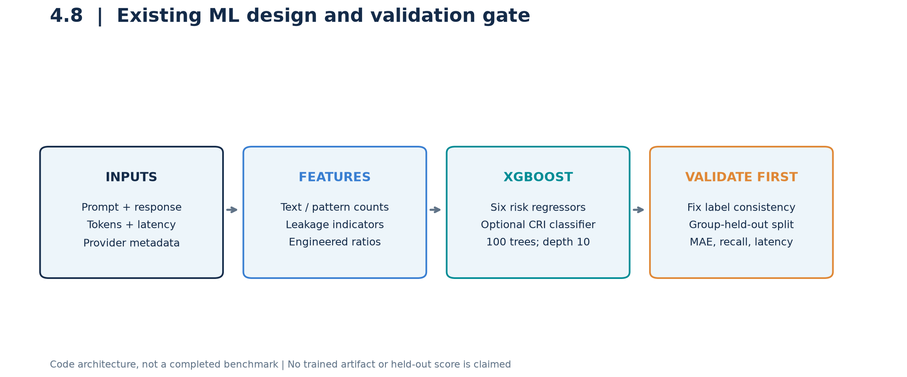
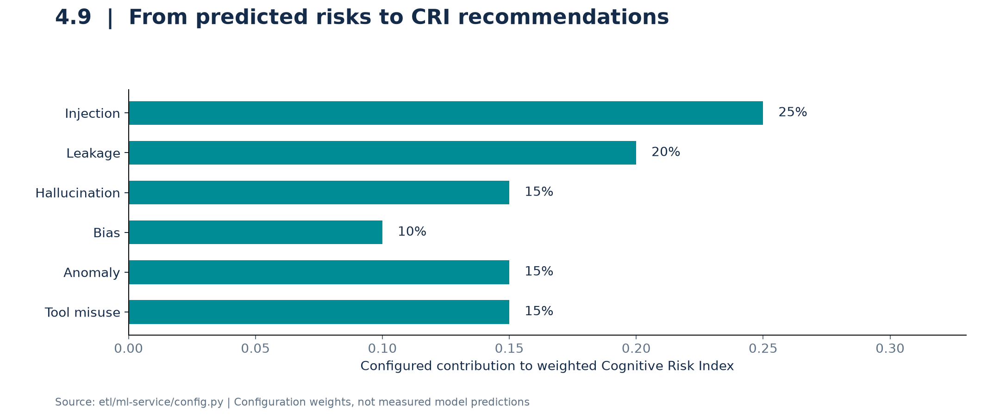
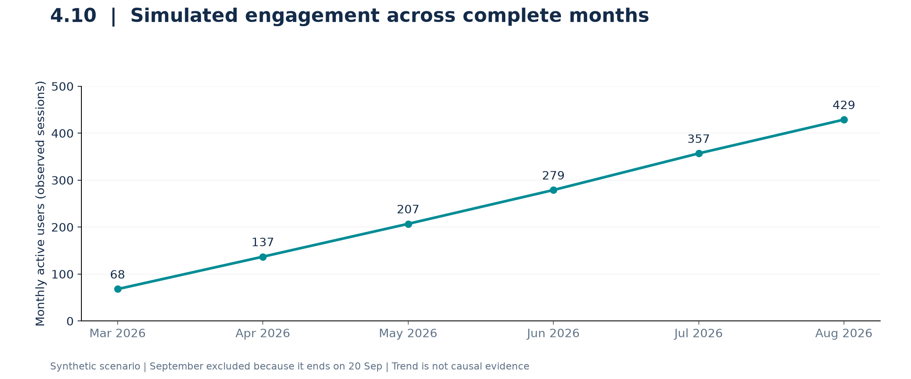

# Chapter 4 | Implementation

## Project: monitr-ai - LLM Observability Platform

Prepared 23 October 2026 | Dataset window: 1 March - 20 September 2026

> Evidence notice: All supplied product-analytics records are SYNTHETIC. Charts are not real customer results. Existing code, descriptive calculations, illustrative arithmetic and proposed work are identified separately. No A/B uplift or trained-model performance is invented.

This chapter addresses Sections 4.1-4.10 with ten reusable figures. It is based on the repository README, analytics CSVs and generator, frontend event/demo code, ETL implementation and ML-service source.

## Contents
- 4.1 Funnel Analysis
- 4.2 Churn Analysis
- 4.3 Data Generators & Import
- 4.4 Analysis and Identifying the Issue(s) and Solution(s) for the Same (With Data Evidence)
- 4.5 Arrive at Strategy and Implement
- 4.6 Synthetic Data Generation
- 4.7 A/B Test
- 4.8 Identify the Right Model and Train
- 4.9 Model Predictions and Recommendations
- 4.10 Observations/Results

## 4.1 Funnel Analysis

Funnel analysis examines how users move from discovering monitr-ai to receiving monitoring value. The supplied synthetic data covers 1 March to 20 September 2026. The funnel uses unique visitors and unique users; multiple API-key configuration rows must not be counted as separate users.

| Stage | Count | Conversion from previous stage |
| --- | --- | --- |
| Website visit | 20,731 | 100.00% (starting population) |
| Account signup | 1,440 | 6.95% |
| API key connected | 964 | 66.94% |
| Activation flag | 813 | 84.34% |

The largest absolute drop is visitor to signup: 19,291 visitors do not create an account. After signup, 476 users do not connect a key, and 151 connected users lack an activation flag. End-to-end flagged activation is 3.92% of visitors; 56.46% of signups receive the activation flag. The dataset reports a one-day median signup-to-configuration delay.

Interpretation: improve landing-page value communication and the provider-connection experience. These are hypotheses supported by simulated drop-offs, not proven reasons for abandonment. The generator defines activation within seven days of key connection, not signup. Importantly, only 804 of the 813 flagged users have any session record: nine synthetic flags are inconsistent with observed activation. Therefore the report calls this an activation-flag funnel, not a verified first-session funnel.

*Figure 4.1. Synthetic acquisition funnel. Counts use the supplied flags, including the nine flagged users without a recorded session.*

Evidence: analytics/data/funnel_overall.csv; user_signups.csv; monitoring_sessions.csv; analytics/generate_data.py (signup and session generation).

## 4.2 Churn Analysis

monitr-ai is described as a pre-launch, free-beta product. Subscription cancellations, paid churn and revenue churn are therefore not appropriate measures. This analysis uses the existing inactivity proxy: an activated user with more than 30 days since the last recorded monitoring session as of 20 September 2026.

| Segment | Inactive / activation flags | Inactivity rate |
| --- | --- | --- |
| Overall | 295 / 813 | 36.3% |
| DSU Campus | 81 / 226 | 35.8% |
| Outside Campus | 214 / 587 | 36.5% |

The campus and outside-campus inactivity rates differ by only 0.7 percentage points. The data does not support a claim that campus users churn substantially more. Outside-campus users activate more often, but their snapshot inactivity is not lower. Usage-history length, recent activation and incident-driven use may affect this proxy; the snapshot denominator is not exposure-adjusted and the nine flagged users without sessions are not identified as inactive by the generator.

A separate retention measure checks whether a user has a session in activation days [28,35). To avoid right-censoring, this report requires the full 35-day observation window. In the August signup cohort, 46 of 63 eligible users return in week four (73.0%). The supplied monthly CSV instead reports 48.4%, using an incompletely observed cohort denominator. These values answer different calculations and must not be silently interchanged. August-to-September return of 77.4% is also provisional because September stops on the 20th.

*Figure 4.2. Snapshot inactivity rates using the existing all-activation-flags denominator.*

Recommended retention actions: opt-in weekly insight summaries, meaningful CRI alerts and first-session support. Evaluate them using mature cohorts rather than treating a synthetic correlation as causation.

## 4.3 Data Generators & Import

The repository has two distinct data-generation paths: a product-analytics generator and a security-training generator. analytics/generate_data.py creates linked CSVs with random seed 42. These files feed the Tableau analytics pack and the figures in this report. They are not exports of real visitors or real campus participants.

| Dataset / component | Purpose | Rows / mechanism |
| --- | --- | --- |
| web_visitors.csv | Acquisition and visitor-to-signup joins | 20,731 rows |
| user_signups.csv | User attributes, onboarding and flags | 1,440 rows |
| api_key_configs.csv | Provider configuration attempts / records | 1,194 rows; 964 users |
| monitoring_sessions.csv | Usage, quality and safety telemetry | 13,385 rows |
| users_dsu_campus / users_outside_campus | Location partitions of signups | 452 + 988 = 1,440 |

For the intended live pipeline, Convex exports telemetry to etl/webhook.ts, which writes to PostgreSQL. dbt staging models standardize raw events; marts aggregate daily metrics, provider comparisons and cognitive waste. The frontend GA4 helper records allowlisted onboarding metadata. The current key-connection demo saves configuration locally, so it should not be described as a verified live API-key validation import. CSV analytics are a separate offline analysis path.

Import validation in this report checks unique visitor/user/session IDs, session-to-user and session-to-config references, and agreement between user session totals and 13,385 session rows. These checks pass. A separate semantic check identifies the nine activation flags without sessions. Before live ingestion, also validate timestamps, duplicate event IDs, redaction, schema versions and webhook authentication.

*Figure 4.3. Conceptual data architecture. It does not assert that external services were deployed or contacted.*

Evidence: analytics/generate_data.py; analytics/build_workbook.py; convex/etlExport.ts; etl/webhook.ts; etl/models/; frontend/analytics.js.

## 4.4 Analysis and Identifying the Issue(s) and Solution(s) for the Same (With Data Evidence)

The following issues are grounded in the supplied synthetic records or inspected code. Proposed causes remain hypotheses until tested on observed product activity.

| Issue and evidence | Interpretation / proposed solution |
| --- | --- |
| Only 6.95% of visitors sign up; 19,291 drop off. | Test clearer value propositions, sample insights and a concise demo CTA. |
| 476 of 1,440 signups lack a connected key (33.1%). | Offer provider guidance and an explicit demo path; measure actual connection success separately. |
| Campus activation 50.0% vs outside-campus 59.4%: a 9.4-point gap. | Test a workshop follow-through checklist; do not infer that location causes low activation. |
| Campus inactivity 35.8% vs outside-campus 36.5%. | Treat inactivity as a shared issue; do not claim disproportionate campus churn. |
| August CWI 0.429 vs the repo target <=0.25; efficiency 0.774 vs >=0.80. | Investigate prompt length, repeated context and provider/model fit; validate changes against quality. |
| Nine activation flags have no session; immature retention cohorts enter some denominators. | Derive observed activation from sessions and require complete retention windows. |
| Synthetic security training repeats benign prompts and uses template-derived labels. | Deduplicate; hold out attack families; obtain independently reviewed labels before deployment. |

*Figure 4.4. Location activation and inactivity use different denominators. Location differences are descriptive, not causal.*

Targets are internal values from kpi_definitions.csv, not externally validated industry benchmarks. Its prefilled status labels are not reliable evidence of target attainment; the numeric comparison above takes precedence.

## 4.5 Arrive at Strategy and Implement

The recommended strategy is to shorten time-to-value, make repeated monitoring useful, and validate security scoring before enforcement. The repository already contains parts of this strategy, but code presence is not proof of production deployment or improved outcomes.

| Workstream | Current evidence | Next implementation / acceptance criterion |
| --- | --- | --- |
| Instrument onboarding | analytics.js records key-entry, submission, acceptance and dashboard events with safe metadata. | Add a server-confirmed first monitoring-session event, deduplication and a defined activation window. |
| Remove demo friction | key.html has DEMO_MODE, provider fallback and local dashboard navigation. | Keep demo vs validated-provider success separate; verify a real provider only in the production flow. |
| Enable recurring value | Feature flags show 65.9% synthetic custom-alert adoption. | Test an opt-in weekly insights digest and useful threshold alerts; monitor opt-outs and false alerts. |
| Make risk scoring safe | ML service contains six-risk scoring and CRI-based actions. | Use shadow mode and independent labels before allowing automated restrictions. |

Priority order: repair metric definitions first; validate the first-session event next; then test onboarding and retention changes. Product analytics owners should track activation, while security owners audit model errors and threshold decisions. This report and ten reproducible figures are implemented deliverables; new product features and live experiments are not claimed as completed.

*Figure 4.5. Strategy roadmap explicitly distinguishes existing code from recommended work.*

Privacy requirement: never place API-key material in analytics events or reports. Existing GA4 safeguards allowlist parameter names and filter secret-looking values. Real credentials should not rely on the demo localStorage mechanism for production security.

## 4.6 Synthetic Data Generation

Synthetic data enables reproducible analytics demonstrations without exposing customer activity. The product generator fixes random.seed(42), uses dates from 1 March to 20 September 2026, and simulates acquisition channels, personas, campus/outside-campus segments, provider setups, usage lifetimes, telemetry and feature adoption.

Primary join paths are anonymous_visitor_id to visitor_id, user_id across signup/config/session tables, and config_id from sessions to configurations. Location-specific user CSVs partition the signup table and must be unioned rather than counted as extra users. Derived funnel, monthly KPI, cohort and feature-adoption CSVs summarize these records.

A second generator in etl/ml-service/processor.py builds security-training examples: five benign prompt templates repeated ten times (50 examples), plus the first three phrases from each of nine attack categories (27 examples). This produces 77 rows, many of which are duplicate or closely related examples. Risk labels are hand-assigned templates, not expert judgments of real attacks.

Generation limitations matter: location, persona and onboarding effects are deliberately encoded in probabilities. Their apparent relationships are simulation assumptions, not discovered behavioral laws. Security labels mainly cover low-risk ranges; they do not adequately validate high or critical risk. Expand scenarios, diversify providers and language, and split by template family before using this data for model evaluation.

*Figure 4.6. Row counts of the primary product-analytics datasets. These are not human participant counts.*

Rebuild original data only when needed: python3 analytics/generate_data.py; python3 analytics/build_workbook.py. This report reads existing CSVs and does not regenerate or overwrite the original analytics pack.

## 4.7 A/B Test

No recorded randomized experiment, treatment assignments or A/B outcomes were found in the inspected project. This section presents a proposed experiment, not a completed test. Hypothesis: guided onboarding with a first-session checklist increases observed activation compared with the current flow.

| Design element | Proposed specification |
| --- | --- |
| Unit and assignment | New signup; stable 50:50 assignment, stratified by collection location; exclude internal/test accounts. |
| Control A | Current onboarding flow. |
| Treatment B | Same flow plus provider guidance, a first-session checklist and one follow-up nudge. |
| Primary outcome | At least one real monitoring session within seven days of signup; intention-to-treat denominator. |
| Secondary / guardrails | Connection success, session quality, mature W4 retention, setup errors, opt-outs and safety alerts. |
| Decision rule | Pre-register sample size and analysis; report absolute uplift and 95% confidence interval after all follow-up windows close. |

Illustrative planning calculation only: using the synthetic flagged signup activation rate p1 = 813/1,440 = 56.46% as a rough baseline and a minimum detectable absolute improvement of 8 percentage points (p2 = 64.46%), a two-sided normal approximation with alpha 0.05 and 80% power requires about 586 signups per arm (1,172 total). Re-estimate this after measuring the real primary outcome, since the synthetic baseline uses a different activation definition. Do not stop early for significance without a sequential-testing design.

Sample-size formula per arm: n = [1.96*sqrt(2*p_bar*(1-p_bar)) + 0.842*sqrt(p1*(1-p1)+p2*(1-p2))]^2 / (p2-p1)^2. No uplift, p-value, confidence interval or winner is reported because no experimental observations exist.

*Figure 4.7. Proposed experiment flow. This is not a chart of observed A/B performance.*

## 4.8 Identify the Right Model and Train

The repository's ML task is event-level security-risk estimation, not user-churn prediction. etl/ml-service/model.py implements MultiOutputRegressor around XGBRegressor to estimate injection, leakage, hallucination, bias, anomaly and tool-misuse risk. An additional XGBClassifier predicts CRI levels. XGBoost is a plausible candidate for engineered tabular features, but it has not been demonstrated to be the best model by this report.

Feature extraction includes prompt/response lengths, attack-pattern indicators, leakage markers, token/latency ratios and provider/model metadata. Default model settings are 100 estimators, maximum depth 10, learning rate 0.1 and random state 42. The fit routine scales features and trains the regressors/classifier. A scaler is not generally required for tree models, but it is present in the code.

| Validation gate | Required action before claiming a trained, reliable model |
| --- | --- |
| Consistent labels | Replace the synthetic trainer's unweighted mean CRI labels with labels based on the configured weighted CRI, or document an independently reviewed target. |
| Coverage and class handling | The 77-row generator supplies minimal/low labels, while the classifier config specifies five classes. Test library compatibility and class handling; add high-risk coverage. |
| Leakage-resistant split | Deduplicate repeated benign prompts; hold out prompt/attack families or later time periods before fitting preprocessing. |
| Candidate comparison | Compare constant/rule baselines, regularized linear regression, random forest and XGBoost using the same folds. |
| Evaluation and audit | Report per-risk MAE/RMSE, high-risk recall, false-positive rates, calibration and inference latency on independent labels. |

The inspected BatchTrainer sends its available examples directly into fit; it does not execute a held-out evaluation. Training entry points are python train.py --synthetic and python train.py --database from etl/ml-service. They require service dependencies and, for the database path, configured labeled data. This report does not run training, certify these commands, create a model artifact or invent accuracy scores.

*Figure 4.8. Existing model design with proposed validation gates, not a completed model-selection result.*

## 4.9 Model Predictions and Recommendations

At inference, the intended service extracts features, predicts six risk values, clips each to [0,1], and computes a weighted Cognitive Risk Index (CRI). The configured equation is CRI = 0.25*injection + 0.20*leakage + 0.15*hallucination + 0.10*bias + 0.15*anomaly + 0.15*tool_misuse.

| CRI range | Configured action | Recommended operational handling |
| --- | --- | --- |
| 0.00 <= CRI < 0.20 | allow | Log and monitor; a low score is not a safety guarantee. |
| 0.20 <= CRI < 0.50 | warn | Show risk context; review flagged content if relevant. |
| 0.50 <= CRI < 0.75 | restrict | Consider limiting tools or sensitive operations after validation. |
| 0.75 <= CRI <= 1.00 | block | Candidate for blocking, with an audited override / review path. |

Worked arithmetic example, not model output: risk vector [0.80, 0.30, 0.20, 0.10, 0.40, 0.20] gives CRI = 0.390. The configured action is warn; the separate trust mapping marks it restricted (trust threshold 0.25). CRI-level category thresholds differ from action thresholds, and the optional classifier can disagree with the weighted-score category. Report these fields separately rather than assuming they are interchangeable.

Recommended user-facing responses include isolating untrusted instructions for injection risk, redacting sensitive output for leakage risk, and checking claims against trusted evidence for hallucination risk. A lexical feature model cannot verify factual truth or prove an interaction safe. Begin in shadow mode; calibrate thresholds and assess false positives before any automated enforcement.

*Figure 4.9. Configured CRI risk weights. No live or trained-model predictions are presented.*

Evidence: etl/ml-service/config.py; model.py (_compute_cri, _get_action, _get_trust_level, predict); main.py prediction endpoints.

## 4.10 Observations/Results

The reproducible result is a descriptive analysis of the existing synthetic project dataset, supported by source inspection. It establishes where the simulated funnel leaks and which measurements need correction; it does not establish real-world business impact.

| Observation | Result and interpretation |
| --- | --- |
| Dataset scale | 20,731 visitors; 1,440 signups; 1,194 key configs; 13,385 sessions. |
| Activation | 813 flagged users (56.46% of signups), but 804 session-observed users; nine flags need reconciliation. |
| Inactivity | 295 / 813 = 36.3% using the repository proxy; not cancellation churn. |
| Location | 50.0% campus vs 59.4% outside-campus activation; no meaningful descriptive campus inactivity excess. |
| Complete-month engagement | Synthetic MAU grows from 68 in March to 429 in August; August DAU/MAU is 20.1%. |
| Quality / safety (August) | CWI 0.429; efficiency 0.774; average CRI 0.205; these are simulated telemetry aggregates. |
| Experiment and ML outcomes | No observed A/B uplift, validated model accuracy or independently measured deployment impact is available. |

*Figure 4.10. Synthetic MAU trend across complete months. Increased simulated usage is not evidence that an intervention worked.*

Conclusion: prioritize clean observed-activation metrics, guided onboarding and validated risk scoring. Use mature cohorts for retention and a randomized test to estimate intervention effects. Keep product-analytics simulation, model training, and real production measurements clearly separated.

Evidence limitations: no live GA4, Firebase, Convex or PostgreSQL data was accessed; no experiment or model training was executed. The original analytics CSVs and application implementation remain unchanged. All ten figures were programmatically created from repository values or labeled implementation/design diagrams.

## Source files and reproduction

Primary sources: `README.md`, `analytics/README.md`, `analytics/summary.json`, `analytics/data/*.csv`, `analytics/generate_data.py`, `frontend/analytics.js`, `frontend/key.html`, `convex/etlExport.ts`, `etl/webhook.ts`, `etl/models/`, and `etl/ml-service/{config,features,model,processor,train,main}.py`.

Reproduce this chapter: `python3 -m venv .venv`, `.venv/bin/pip install -r "product analytics/requirements.txt"`, then `.venv/bin/python "product analytics/build_report.py"`. Original source datasets are read-only inputs. `evidence.json` records computed counts and mature week-four retention.
